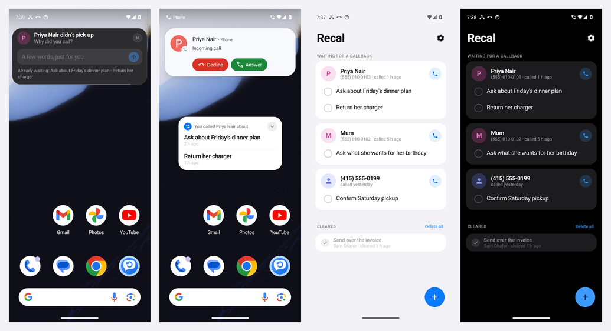
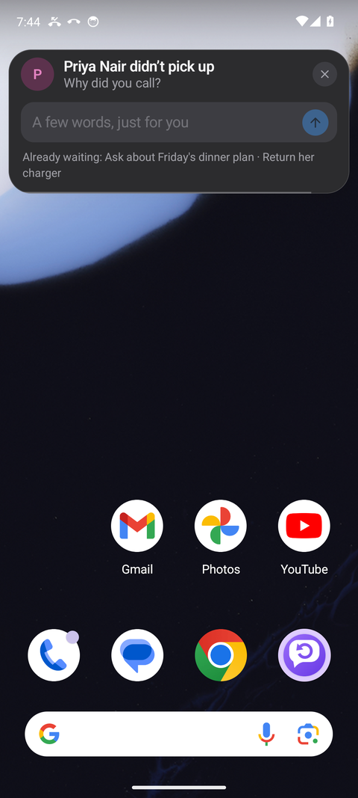
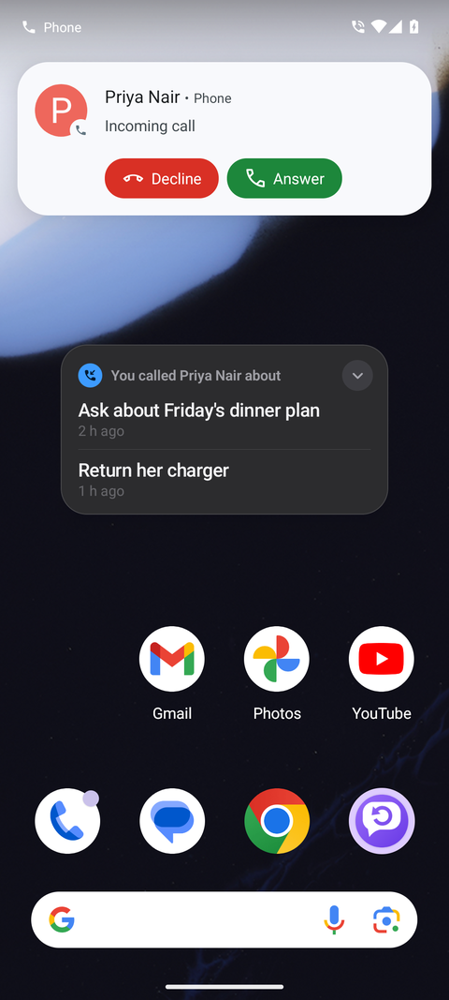
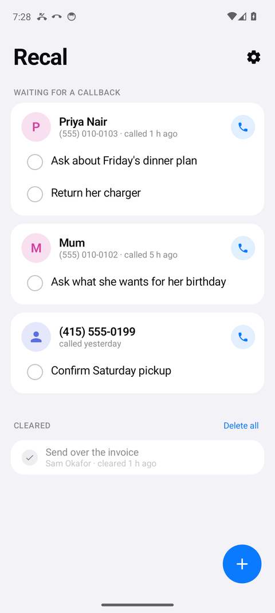
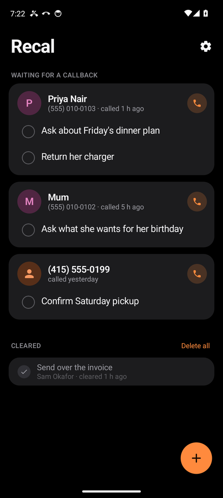

<div align="center">



# Recal

**Remember why you called.**

A tiny, offline Android utility. When someone doesn't pick up, Recal asks *why you called*.
When they ring back, your reason is already on screen. Once you've talked, it clears itself.

[](https://github.com/manojanasuri16/Recal/releases/latest)
[](LICENSE)


[**Get it on AppDrop**](https://appdrop-store.vercel.app/apps/recal)
&nbsp;·&nbsp;
[**Download the APK**](https://github.com/manojanasuri16/Recal/releases/latest)

</div>

---

## The problem

You call someone. They don't answer. By the time they call back, you've forgotten what it was about,
so you say "you called?" and they say "no, *you* called me."

Recal closes that loop and nothing else. No accounts, no cloud, no CRM, no AI. Just the reason, kept
against the person, and shown at the moment you need it.

## How it works

| When | What Recal does |
| --- | --- |
| You call and they don't answer (no answer, declined, busy) | A compact card asks **"Why did you call?"**. A few words, one tap. |
| You try again and they still don't answer | A fresh reminder is added. Everything already waiting is listed under the field. |
| They call you back | A small bubble shows your reason(s) **before you answer**, and stays during the call. It also works over the lock screen. |
| You answer and the call ends | Every reminder that was waiting is cleared automatically. The bubble confirms with a green check. |
| You miss or reject the callback | Nothing is cleared. The reminder waits for the next attempt. |
| You reach them on an outgoing call while reminders are waiting | A card asks **"Did you cover this?"**. Nothing is cleared without your say-so. |

Reminders can also be added by hand with the **+** button, and ticked off from the home screen.

### In-call Notes *(optional, off by default)*

Turn it on in Settings and the same bubble becomes a per-contact scratchpad during any call:
read what you wrote last time, add a line, move on.

## Screenshots

<table>
  <tr>
    <td align="center"><br><sub>After a missed call</sub></td>
    <td align="center"><br><sub>When they call back</sub></td>
    <td align="center"><br><sub>Home, light</sub></td>
    <td align="center"><br><sub>Home, dark</sub></td>
  </tr>
</table>

## Design principles

- **Quiet by default.** A card at the top of the screen and a small bubble. Never a full-screen takeover, never a
  popup you have to hunt for. Anything can be swiped away.
- **Private by construction.** No `INTERNET` permission, so nothing *can* leave the phone. Data lives in a local
  database in the app's private storage, with backups switched off. Uninstalling removes it.
- **Lock-screen aware.** Most calls are answered with the phone locked, so Recal works there too, and you can keep
  your reasons off the lock screen entirely (Settings → *Show reasons on lock screen*).
- **Light and dark.** Follows the system, or pick one in Settings.
- **Small.** One purpose, a handful of screens, a ~1.2 MB APK.

## Install

1. Get it from [AppDrop](https://appdrop-store.vercel.app/apps/recal), or download the **APK** from the [latest release](https://github.com/manojanasuri16/Recal/releases/latest).
2. Open it on your phone and allow installing from your browser or file manager if asked.
3. Open Recal and follow the three-step setup:

| Permission | Why |
| --- | --- |
| **Phone & call log** | To notice calls, know who is calling, and read whether a call actually connected. |
| **Display over other apps** | To draw the small bubble over the call screen. |
| **Notifications** | A fallback when the bubble or card can't appear. |
| Contacts *(optional)* | To show names instead of numbers. |

> **Android 13 and newer:** for sideloaded apps, Android may grey out some of these with *"Restricted setting"*.
> Open **Settings → Apps → Recal**, tap **⋮** in the corner, choose **Allow restricted settings**, then grant the
> permission again.

> **Xiaomi, Samsung, OnePlus and similar:** these phones also need background pop-ups and battery limits relaxed.
> Recal's Settings screen shows the exact steps for your phone, and [docs/LIMITATIONS.md](docs/LIMITATIONS.md)
> lists them all.

Requires Android 8.0 (API 26) or newer.

## Good to know

Recal is an ordinary app, not your phone's dialer, so it sees only what Android shows every app. The honest
consequences:

- Android can't tell an app whether an outgoing call was answered *while it's happening*, so Recal decides **a second
  or two after you hang up**, from the call log.
- If **voicemail** picks up, Android records the call as answered and Recal stays quiet. Use **+** to add the reason.
- **WhatsApp and other internet calls** aren't visible to Recal. Hidden numbers can't be matched.
- It isn't on Google Play, because Play restricts the call-log permission this needs. Sideloading is the intended route.

The full list, with the reasoning, is in [docs/LIMITATIONS.md](docs/LIMITATIONS.md).

## Build from source

Requires JDK 17+ and the Android SDK (platform 35).

```bash
git clone https://github.com/manojanasuri16/Recal.git && cd Recal
./gradlew testDebugUnitTest     # lifecycle + number-matching tests
./gradlew assembleDebug         # app/build/outputs/apk/debug/app-debug.apk
./gradlew assembleRelease       # signed if RECAL_STORE_* are set in ~/.gradle/gradle.properties
```

The reminder lifecycle (ask, keep on a missed callback, clear on an answered one, multiple reminders, fresh reminders
on later unanswered calls) is unit-tested against call-log rows exactly as Android writes them.

## How it's built

Kotlin, Jetpack Compose, Room. A manifest `PHONE_STATE` receiver wakes the app per call (no always-on service);
the call log is the source of truth for whether a call connected; a small overlay window carries the bubble and a
floating Activity carries the question. Details and the reasoning behind each choice:

- [docs/ARCHITECTURE.md](docs/ARCHITECTURE.md): detection, lifecycle, windows, and why.
- [docs/LIMITATIONS.md](docs/LIMITATIONS.md): what Android does and doesn't allow.
- [docs/RESEARCH.md](docs/RESEARCH.md): competitor and platform research behind the decisions.

## Contributing

Issues and pull requests are welcome, especially **reports from real phones** (brand, Android version, dialer, what
you saw). Behaviour differs a lot between manufacturers, and that is the hardest part to test.

## License

[MIT](LICENSE)
